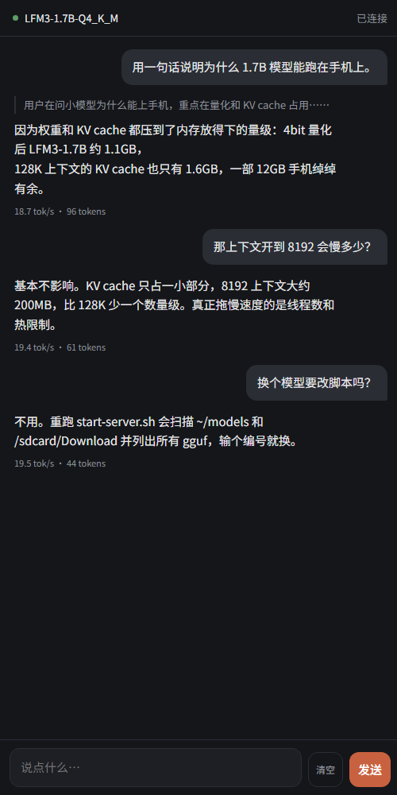

# LFM3 on Android

在安卓手机上跑 **Liquid AI LFM3-1.7B**，针对 **骁龙 8 Gen 1（SM8250）** 调过参的一份可直接落地的记录 + 预编译产物。

Redmi K50 / 12GB / Android 17 实测：**19.5 tok/s 生成，60 tok/s prompt**（Q4_K_M，8192 上下文，4 线程）。



---


## 先说清楚：这个东西和已有项目的区别

安卓上跑本地模型，已经有人做过，而且做得不错：

| 项目 | 做法 | 差异 |
|---|---|---|
| [orailnoor/termux-llm](https://github.com/orailnoor/termux-llm) | 一键脚本装 llama.cpp，`llama-server` 在 `127.0.0.1:8080` 同时托管聊天页和 OpenAI API | 架构与本项目相同 |
| [cycloarcane/llama-termux-setup](https://github.com/cycloarcane/llama-termux-setup) | Termux 内原生编译，配 `serve.sh`/`stop.sh` | 要在手机上编译 10–15 分钟 |
| [paragon83114/llama-adreno](https://github.com/paragon83114/llama-adreno) | Adreno GPU OpenCL 加速 | 走 GPU 路线 |

另外 **上游 llama.cpp 自带 webui**（编译时 assets 齐全即可），所以「server 顺带托管聊天页」本身不是任何人的原创。

本仓库不重复那部分。它只解决三个别人没覆盖的问题：

1. **不需要在手机上编译。** 全部产物是 NDK 交叉编译 + strip 过的 arm64 二进制，10 个文件 16MB，push 进去直接跑。
2. **能跑 LFM3。** `lfm3` 架构 2026-10-27 17:06 才进 llama.cpp master（[PR #31252](https://github.com/ggml-org/llama.cpp/pull/31252)），Termux 仓库版本和所有基于 `llama.rn` 的 App（PocketPal、Maid）都还没跟上，加载必报 `unknown model architecture`。
3. **骁龙 8 Gen 1 的正确参数，以及两个会让速度掉到 0.2 tok/s 的坑。** 见 [docs/PERFORMANCE.md](docs/PERFORMANCE.md)。

---

## 30 秒上手

前置：手机已装 Termux（**必须 F-Droid 版**，Play Store 版已废弃）、已 `termux-setup-storage`。

```bash
# 1. 模型（约 1.1GB）
#    官方 GGUF：https://huggingface.co/LiquidAI/LFM3-1.7B-GGUF
#    国内建议走 ModelScope（实测 14MB/s，hf-mirror 只有 34KB/s）：
#    https://modelscope.cn/models/LiquidAI/LFM3-1.7B-GGUF
curl -L -o ~/LFM3-1.7B-Q4_K_M.gguf \
  "https://modelscope.cn/models/LiquidAI/LFM3-1.7B-GGUF/resolve/master/LFM3-1.7B-Q4_K_M.gguf"

# 2. 二进制 + 启动脚本（zip 里已带好，扁平解压到 ~/lfm3）
#    不要放 /sdcard，原因见 docs/PERFORMANCE.md「坑 1」
mkdir -p ~/lfm3 && cd ~/lfm3
curl -L -o lfm3.zip \
  https://github.com/AIR-pixel/lfm3-android/releases/download/v0.1.0/lfm3-android-arm64.zip
unzip -o lfm3.zip     # 没有 unzip 先 pkg install unzip

# 3. 跑
bash ~/lfm3/start-server.sh
```

脚本默认模型路径是 `~/LFM3-1.7B-Q4_K_M.gguf`，放在别处就传参：`bash ~/lfm3/start-server.sh /path/to/model.gguf [上下文] [线程数]`。

然后手机浏览器打开 **`http://127.0.0.1:8080`** —— 直接就是聊天界面，不用装 App，不用 `file://`。

想连外部客户端（SillyTavern / Open WebUI / GPTMobile 等），OpenAI 兼容端点在 `http://127.0.0.1:8080/v1`。

---

## 目录

```
app/lfm3-chat.html        聊天页源码（流式输出、思考折叠、tok/s、localStorage 历史）
app/chat_page.h           上面那个页面的 C++ 原始字符串常量版（给补丁用）
patches/                  把聊天页塞进 llama-server 的改法
scripts/build-android.sh  NDK 交叉编译脚本
termux/start-server.sh    起 HTTP 服务 + 内置聊天页（release zip 里也带了一份）
termux/start-chat.sh      纯终端对话
docs/BUILD.md             构建细节与踩坑
docs/PERFORMANCE.md       实测性能、线程数对比、两个致命坑
```

---

## 实测数据

Redmi K50（SM8250，X2@3.0GHz ×1 + A710 ×3 + A510 ×4），LFM3-1.7B-Q4_K_M，8192 ctx：

| 线程 | 生成 tok/s | prompt tok/s |
|---|---|---|
| 3 | 19.4 | 52 |
| **4** | **19.5** | **60** |
| 5 | 13.5 | — |
| 6 | 13.1 | — |
| 8 | 14.3 | — |

**4 线程最优。** 上到 8 线程会被 4 颗 A510 小核拖累，反而更慢。

---

## 已知限制

- 只验证了 arm64-v8a + `armv8.2-a+dotprod`。**不要加 `i8mm`**，SD 8 Gen 1 没有这个扩展，会 `Illegal instruction`。
- 模型即使传 `chat_template_kwargs={"enable_thinking":false}` 仍会输出思考内容并残留 `</think>`，聊天页里按 `</think>` 做切分处理。
- Termux 进程通常被 MIUI 限在 `Cpus_allowed_list: 4-6`，3.0GHz 的 X2 用不上。这是手机端 2 tok/s 和 19.5 tok/s 的真正差别，详见性能文档。
- 2026 年后的 llama-server 已移除 `--path` 静态托管和内嵌 webui，所以本项目的聊天页是靠 [patches/](patches/) 里的源码补丁挂上去的。上游升级会覆盖补丁。

## 许可

本项目脚本与页面 MIT。预编译二进制由 [llama.cpp](https://github.com/ggml-org/llama.cpp)（MIT）编译而来，遵循其许可。

模型权重遵循 **LFM Open License v1.0**：年营收低于 1000 万美元可商用，达到或超过需与 Liquid AI 单独签约。本仓库不包含模型权重。
